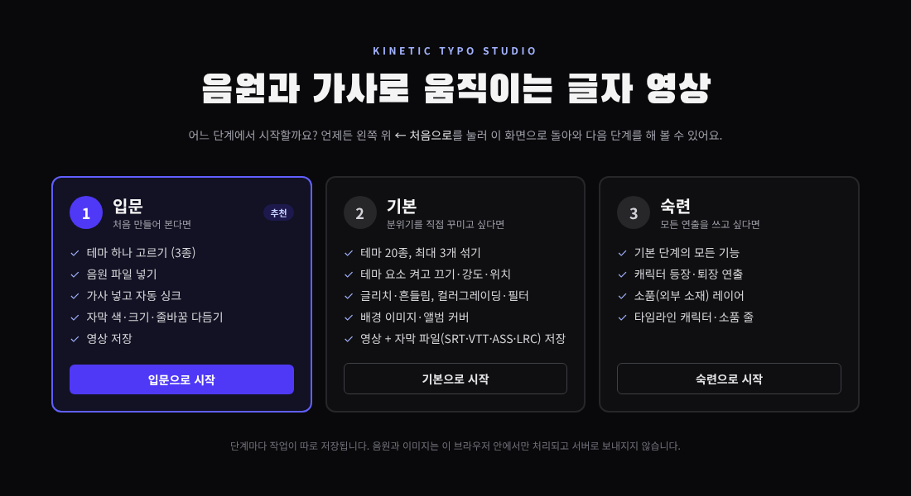
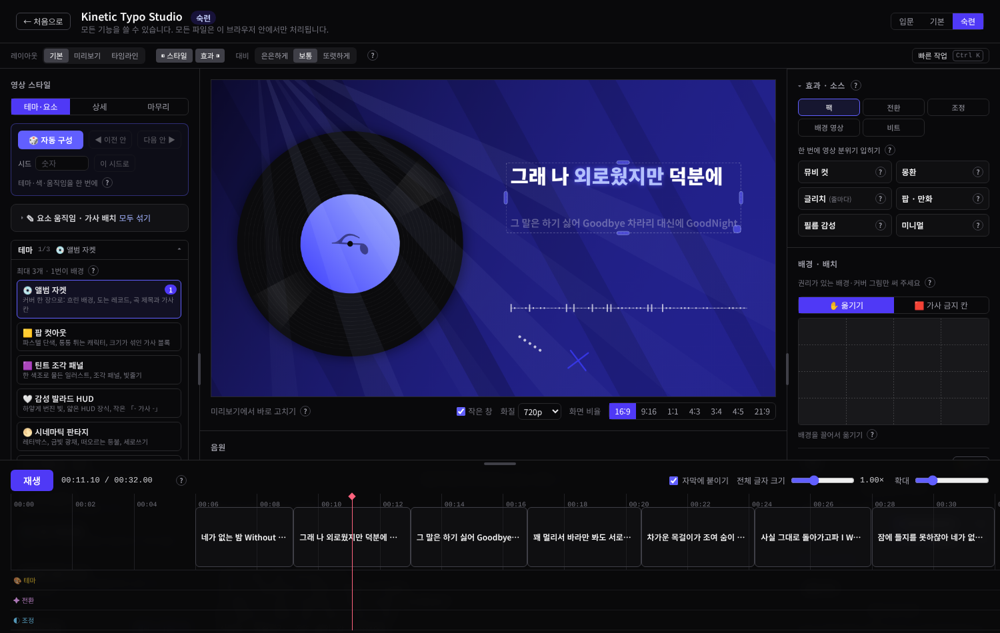
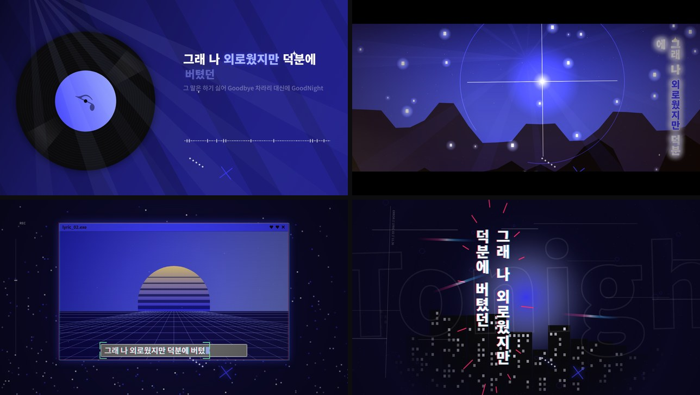
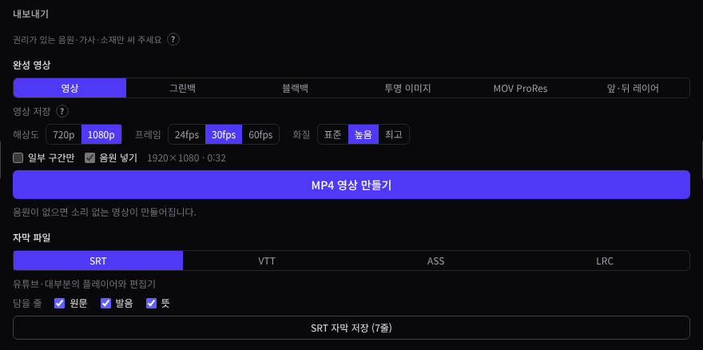
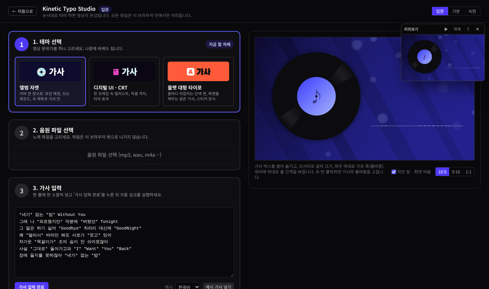
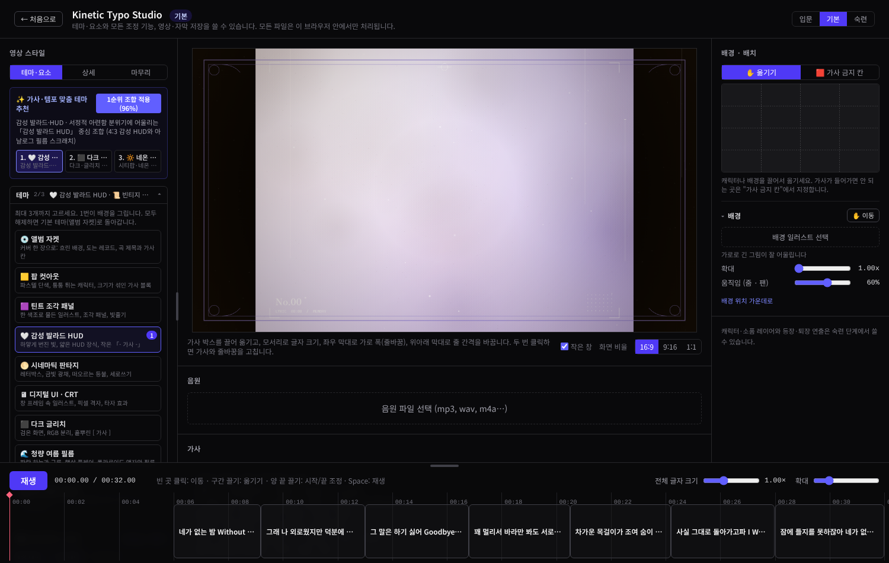

# Kinetic Typo Studio

음원과 가사로 키네틱 타이포그래피 영상을 만드는 웹 편집기입니다. 영상 편집 경험이 없어도 노래와 가사만 넣으면 영상을 만들 수 있습니다.

## 기능

### 가사 싱크
- 음원을 인식해 가사 줄마다 시간을 자동으로 맞춥니다.
- 보컬 분리를 켜면 반주를 걸러 내고 인식합니다.
- 한국어는 소리 나는 대로, 일본어는 한자 읽기까지 비교해 맞춥니다.
- 타임라인에서 줄을 끌어 시간을 고치고, 단어·글자 단위로 나오는 순간을 정할 수 있습니다.
- 앞 줄에 `&`를 붙이면 코러스처럼 동시에 부르는 줄이 됩니다.

### 테마와 글자 움직임

- 테마 20종 중 최대 3개를 골라 섞어 씁니다. 가사와 템포에 맞는 조합을 추천받을 수도 있습니다.
- 테마 요소의 위치·회전·크기·강도를 조절합니다.
- 가사 움직임 67종, 가로쓰기·세로쓰기를 줄마다 고를 수 있습니다.
- 가사 모션 스타일 4종(스무스 리빌, 하이프 팝인, 에디토리얼 블러, 하이라이트 박스)으로 색은 테마대로 두고 움직임과 조판만 바꿉니다.
- 천천히 다가가는 가상 카메라와 강조 단어의 튕김, 고른 색에서 계산한 배경(단색·스포트라이트·오로라)과 글자 대비를 씁니다.
- 글자가 조각나 흩어졌다 모이는 움직임과 흩어진 점이 모여 글자가 되는 움직임이 있습니다.
- 가사 뒤에 유리판(맑게·젖빛)을 깔거나, 가사를 기울어진 카드처럼 띄우는 2.5D 깊이감을 줍니다.
- `*단어*`로 표시한 곳만 강조색과 강조 연출이 들어갑니다.
- 오프닝·엔딩 제목 카드, 비트에 맞춘 빛남, 간주 카운트다운을 넣습니다.

### 자막

- 원문은 화면 가운데에, 발음과 뜻은 아래 자막으로 함께 보여 줍니다.
- 글자 색·크기·글꼴·줄바꿈 폭·줄 간격을 미리보기에서 바로 바꿉니다.
- 배경에 따라 글자 대비를 자동으로 맞춥니다.

### 배경과 일러스트
- 배경 이미지, 앨범 커버, 무료 배경 영상을 쓰고 영상에만 필터를 겁니다.
- 캐릭터 등장·퇴장 연출과 소품 레이어를 타임라인에서 다룹니다.
- 일러스트 마스킹, 가사가 들어가지 않을 칸 지정이 됩니다.
- 컬러그레이딩, 필름 질감, 전환 효과를 구간마다 넣습니다.

### 내보내기

- 영상: MP4 또는 WebM, 720p·1080p·1440p·4K, 24·30·60fps
- Chrome·Edge에서는 만들면서 바로 파일에 저장해 긴 영상도 메모리를 덜 씁니다.
- 합성용: ProRes, 투명 배경 이미지 시퀀스(PNG·TGA·SGI)
- 자막 파일: SRT, VTT, ASS, LRC (원문·발음·뜻 중 고르기)

## 단계

| 단계 | 대상 | 쓸 수 있는 기능 |
| --- | --- | --- |
| 입문 | 처음 만들어 본다면 | 테마 1개, 음원, 가사·자동 싱크, 자막 다듬기, 영상 저장 |
| 기본 | 분위기를 직접 꾸미고 싶다면 | 테마 3개 섞기, 요소 조절, 그레이딩·필터, 배경, 자막 파일 저장 |
| 숙련 | 모든 연출을 쓰고 싶다면 | 기본 기능 전체, 캐릭터 등장·퇴장, 소품 레이어 |

 

## 개인정보

음원, 가사, 그림은 서버로 올라가지 않습니다. 인식, 렌더링, 인코딩 모두 브라우저 안에서 처리됩니다.

## 라이선스

### 이 앱

Kinetic Typo Studio의 코드(아래 제3자 구성 요소를 뺀 부분)는 **Copyright © 2026 i2nu. All rights reserved.** 입니다. 코드를 보고 평가 목적으로 내 컴퓨터에서 실행해 보는 것은 허락되지만, 저작권자의 서면 허락 없이 복사·수정·재배포하거나 서비스로 제공할 수 없습니다. 전문은 [LICENSE](kinetic-typo-django/LICENSE)에 있습니다.

### 앱에 들어 있는 라이브러리

빌드된 편집기(`static/js/`)에 함께 묶여 배포됩니다. 모두 상업적 사용을 허락하는 라이선스입니다.

| 라이브러리 | 버전 | 라이선스 | 쓰는 곳 |
| --- | --- | --- | --- |
| React, React DOM, scheduler | 19.1.0 / 0.26.0 | MIT | 편집기 화면 |
| Zustand | 5.0.16 | MIT | 편집기 상태 관리 |
| mediabunny | 1.61.3 | MPL-2.0 | MP4·WebM 인코딩. 고치지 않고 그대로 사용하며, 원본 소스는 [github.com/Vanilagy/mediabunny](https://github.com/Vanilagy/mediabunny)에서 받을 수 있습니다. |
| @huggingface/transformers | 3.8.1 | Apache-2.0 | Whisper 음성 인식 실행 |
| onnxruntime-web, onnxruntime-common | 1.22.0-dev / 1.30.0 | MIT | 인식·보컬 분리 모델 실행 |
| @audio/neural-separate, @audio/neural-runtime | 0.7.0 / 0.2.0 | MIT | 보컬 분리 |
| @audio/resample-sinc | 1.3.0 | MIT | 오디오 샘플레이트 변환 |
| fourier-transform | 2.5.1 | MIT | 비트 분석 |
| @ffmpeg/ffmpeg, @ffmpeg/util | 0.12.15 / 0.12.2 | MIT | ProRes 내보내기 연결 코드 |
| @tauri-apps/api | 2.12.4 | Apache-2.0 또는 MIT | 데스크톱 앱 연결 |

서버 쪽은 Django 5.2.18(BSD-3-Clause)과 Jinja2 3.1.6(BSD-3-Clause)을 씁니다.

### 글꼴 (32종)

[Google Fonts](https://fonts.google.com)에 공개된 무료 글꼴 31종은 [Fontsource](https://fontsource.org) 패키지에서, 기본 가사 글꼴 Pretendard는 `pretendard` 패키지(1.3.9)에서 받아 `static/fonts/`에 넣고 이 사이트에서 직접 내보냅니다. 각 폴더에 라이선스 원문이 들어 있습니다.

| 라이선스 | 글꼴 |
| --- | --- |
| SIL Open Font License 1.1 | 한국어: Pretendard, Noto Sans KR, Black Han Sans, Do Hyeon, Jua, Nanum Gothic, Gothic A1, Gowun Dodum, Nanum Myeongjo, Gowun Batang, Nanum Pen Script 일본어: Noto Sans JP, M PLUS 1, M PLUS Rounded 1c, Zen Maru Gothic, Dela Gothic One, RocknRoll One, DotGothic16, Shippori Mincho, Klee One 영문: Montserrat, Poppins, Inter, Anton, Bebas Neue, Oswald, Raleway, Nunito, Playfair Display, JetBrains Mono |
| Apache License 2.0 | Kosugi Maru, Permanent Marker |

### 쓸 때 내려받는 파일

앱에 넣지 않고, 해당 기능을 처음 쓸 때 브라우저가 받아 캐시합니다.

| 파일 | 쓰는 곳 | 라이선스 | 받는 곳 |
| --- | --- | --- | --- |
| Whisper base · small · large-v3-turbo (ONNX) | 자동 싱크 음성 인식 | MIT (OpenAI Whisper) | Hugging Face `onnx-community` |
| SCNet (int8) | 보컬 분리, 가볍게 | MIT (가중치: starrytong/SCNet) | Hugging Face `audiojs/scnet`, 고정 버전 + SHA-256 확인 |
| Mel-Band RoFormer (fp16) | 보컬 분리, 정밀하게 | MIT (가중치: KimberleyJSN/melbandroformer) | Hugging Face `audiojs/mel-roformer`, 고정 버전 + SHA-256 확인 |
| onnxruntime-web WebAssembly 1.22 · 1.30 | 모델 실행 | MIT | jsDelivr |
| FFmpeg (@ffmpeg/core 0.12.10) | ProRes(MOV) 내보내기 | GPL-2.0-or-later | jsDelivr (실패하면 unpkg) |
| Mixkit 무료 배경 영상 | 배경 영상 고르기 | Mixkit Stock Video Free License | assets.mixkit.co |
| whisper.cpp ggml 모델 | 데스크톱 앱의 GPU 음성 인식 | MIT | Hugging Face `ggerganov/whisper.cpp` |

- FFmpeg는 GPL이라 앱 코드와 묶지 않고, ProRes로 내보낼 때만 공개 CDN에서 따로 받습니다.
- Mixkit 영상은 상업 영상·뮤직비디오에 출처 표기 없이 쓸 수 있지만, 영상 파일 자체를 팔거나 다시 배포할 수는 없습니다.

### 직접 넣는 소재와 만든 영상

- 영상에 넣는 음원·가사·그림·영상의 권리는 각 권리자에게 있습니다. 직접 만들었거나 허락받은 소재만 쓰고, 공개하기 전에 저작권을 확인해 주세요.
- 만든 영상은 만든 사람의 것입니다. 단, 그 안에 넣은 소재의 권리는 따로 따릅니다.

### 원문 보기

모든 라이선스 원문은 [THIRD_PARTY_NOTICES.txt](kinetic-typo-django/static/licenses/THIRD_PARTY_NOTICES.txt)에 모여 있고, 앱의 `/licenses/` 페이지에서도 볼 수 있습니다. 이 파일은 빌드할 때 실제로 묶인 패키지와 글꼴을 보고 자동으로 다시 만들어집니다.
